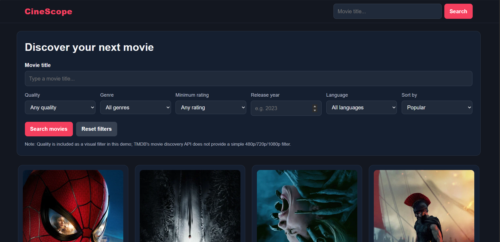
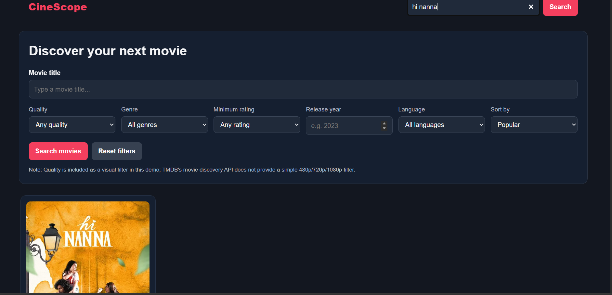
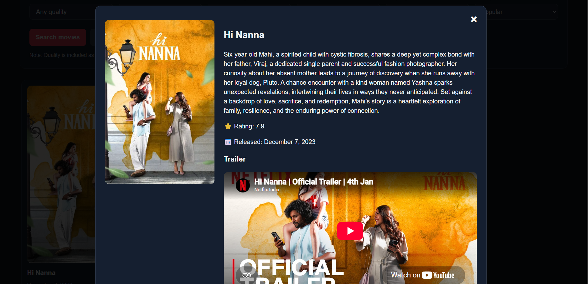

# CineScope — Movie Discovery Website

CineScope is a responsive movie discovery website built with HTML, CSS, and vanilla JavaScript. It uses the **TMDB API** to display popular movies, search movie titles, apply filters, view movie details, and watch available YouTube trailers.

## Live Demo

**Live Website:** [View CineScope](https://your-username.github.io/CineScope_Project/)

> Replace the link above with your actual GitHub Pages URL after deploying your project.

## Screenshots

### Dashboard


### Search Movie


### Search Results


## Folder Structure

```text
CineScope_Project/
├── index.html
├── README.md
├── css/
│   └── main.css
├── js/
│   ├── config.js
│   └── main.js
├── assets/
│   └── images/
│       └── imageNotFound.svg
└── docs/
    └── screenshots/
        ├── dashboard.png
        ├── search_movie.png
        └── search_result.png
```

## Requirements

- A modern web browser (Chrome, Edge, Firefox, etc.)
- Internet connection
- TMDB account and API key
- Visual Studio Code (recommended)
- Live Server extension for VS Code (recommended for local development)

## Setup and Run

1. Download or clone this repository.
2. Open the `CineScope_Project` folder in VS Code.
3. Open `js/config.js`.
4. Replace `YOUR_TMDB_API_KEY` with your own TMDB API key.
5. Right-click `index.html` and select **Open with Live Server**.
6. Use the search field and filters to explore movies.

**Note:** Never commit a private API key to a public GitHub repository. For production applications, consider using a backend to protect credentials where appropriate.

## Main Features

1. **Popular Movies:** Displays popular movies retrieved from TMDB.
2. **Movie Search:** Search for movies by title.
3. **Movie Filters:** Filter discovery results by genre, minimum rating, release year, original language, and sort order.
4. **Movie Cards:** Display movie posters, titles, release dates, and ratings.
5. **Movie Details Modal:** View movie descriptions, ratings, release dates, and available YouTube trailers.
6. **Responsive Design:** Adapts the movie grid and footer to desktop, tablet, and mobile screens.
7. **Reset Filters:** Clear the search and restore popular movie results.
8. **Error Handling:** Displays helpful messages when the API key is missing or a request fails.

## Technologies Used

- **HTML5:** Structures the website, search controls, movie results, modal, and footer.
- **CSS3:** Styles the website, movie cards, modal, layout, and responsive design.
- **JavaScript:** Fetches movie data, generates movie cards, manages search and filter events, and handles movie details.
- **TMDB API:** Provides movie information, posters, ratings, release dates, genres, and available video information.
- **YouTube Embed:** Displays available movie trailers.

## Important Notes

- The quality selector (480p, 720p, and 1080p) is a UI example and does not filter TMDB discovery results by streaming resolution.
- Movie title searches use the TMDB search endpoint. The release year can be passed as a search parameter.
- Genre, rating, language, and sorting filters apply to the Discover endpoint when no title is entered.
- Poster images and trailers depend on the information available from TMDB.
- Follow TMDB's terms of use and attribution requirements.

## How to Add Screenshots

Save your screenshots using these exact filenames:

- `dashboard.png`
- `search_movie.png`
- `search_result.png`

Place all three images inside `docs/screenshots/`. The images will then appear automatically in the GitHub README when the files are committed and pushed.

## Deployment

You can deploy CineScope using **GitHub Pages**:

1. Push your project to a GitHub repository.
2. Open the repository's **Settings**.
3. Select **Pages**.
4. Under the build and deployment settings, choose **Deploy from a branch**.
5. Select the `main` branch and `/ (root)` folder.
6. Click **Save**.
7. Wait for GitHub Pages to publish the website and copy the generated URL into the Live Demo section above.

Make sure the API configuration works on the deployed website and that you follow TMDB's API key security and attribution requirements.

## Author

Developed as a movie discovery website project using HTML, CSS, JavaScript, and the TMDB API.
